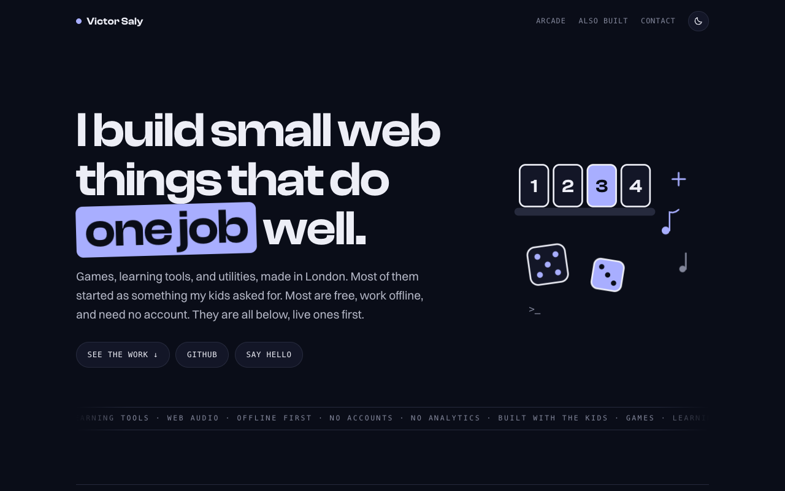
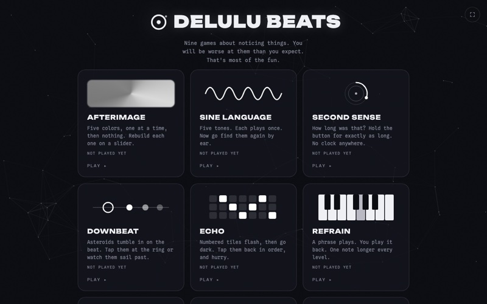
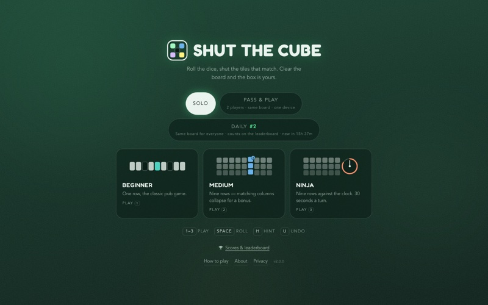
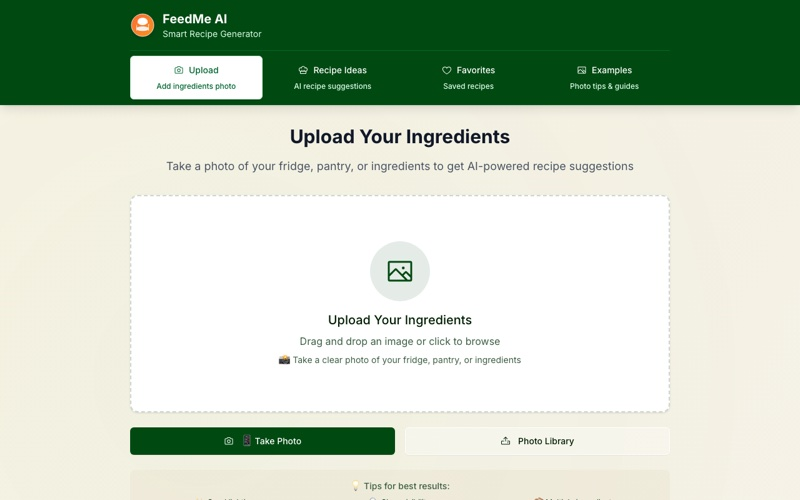
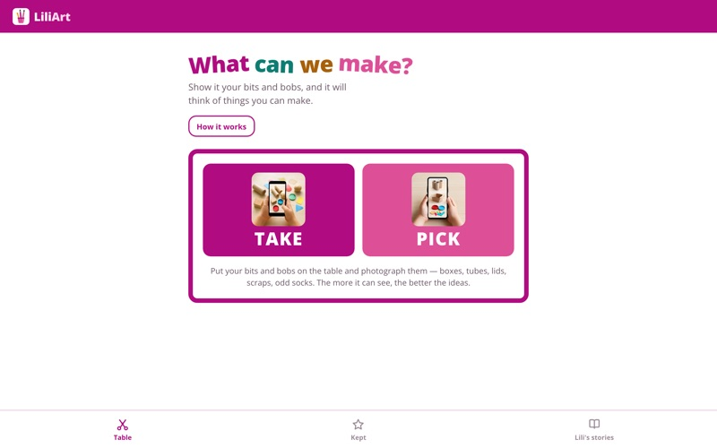
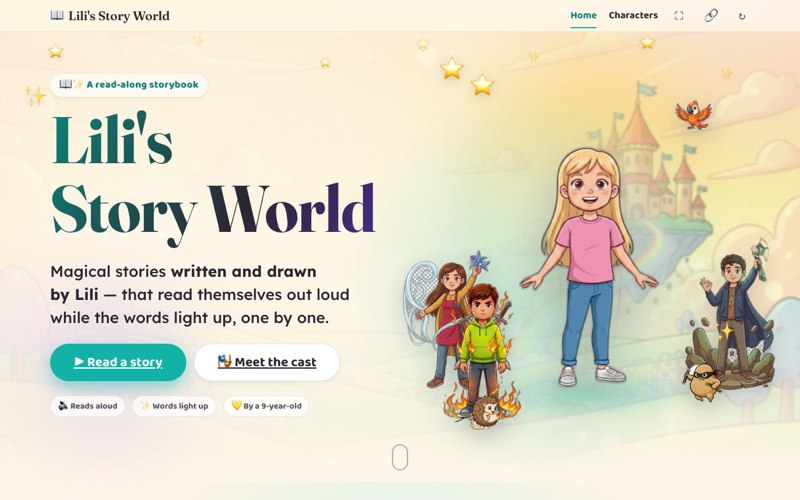
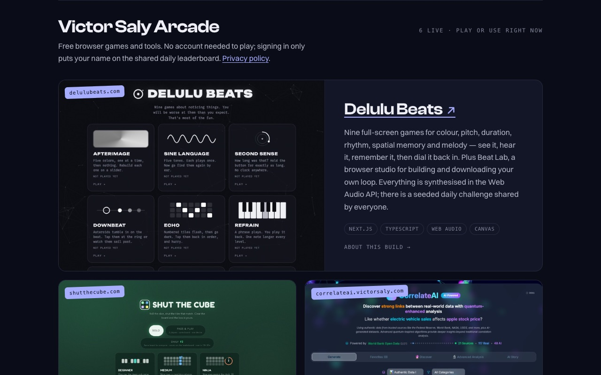
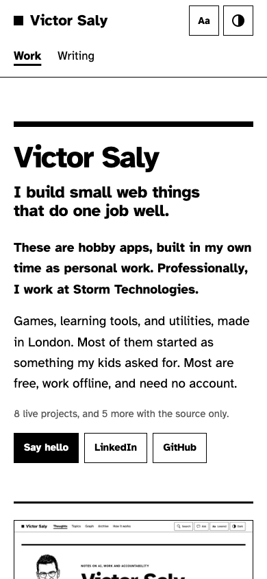
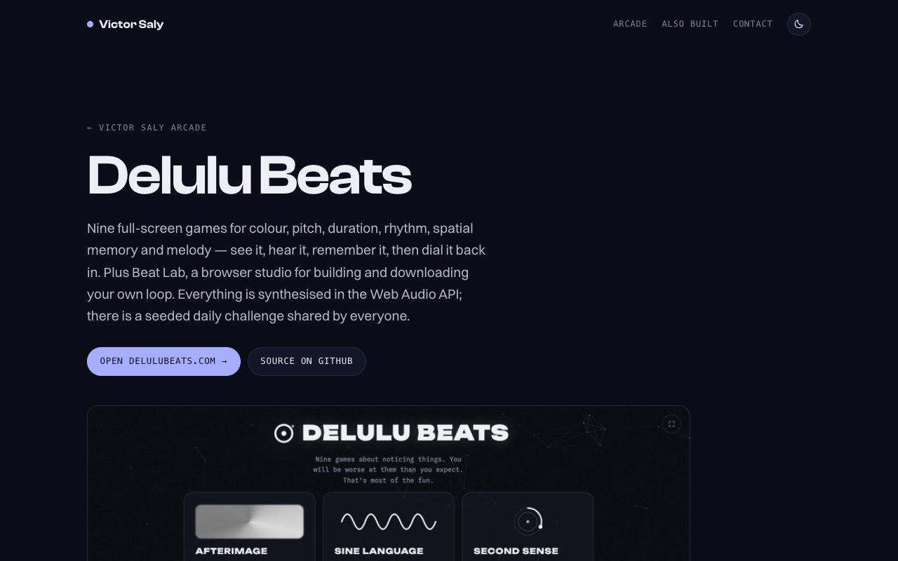

# victorsaly.com

My personal site: a shelf of the browser games, learning tools and utilities I have built, most of
them free, offline-friendly and account-free.

**Live: [victorsaly.com](https://victorsaly.com/)**



## What's on the shelf

### Live projects

Each one links to the live app and has its own write-up at `/work/<slug>` on the site.

| | Project | What it is |
|---|---|---|
|  | **[Delulu Beats](https://delulubeats.com)**<br>[about](https://victorsaly.com/work/delulu-beats) · [source](https://github.com/victorsaly/delulubeats) | Nine ear- and eye-training games (colour, pitch, duration, rhythm, spatial memory, melody) plus Beat Lab, a loop builder. All sound is synthesised with the Web Audio API; seeded daily challenge. |
|  | **[Shut The Cube](https://shutthecube.com)**<br>[about](https://victorsaly.com/work/shut-the-cube) · [source](https://github.com/victorsaly/shutTheCube) | The pub dice game Shut the Box, plus a nine-row variant where matching columns collapse for a bonus. Installable PWA, plays offline, daily leaderboard. |
|  | **[CorrelateAI](https://correlateai.victorsaly.com)**<br>[about](https://victorsaly.com/work/correlateai) · [source](https://github.com/victorsaly/correlateAI) | Pulls real series from FRED and World Bank data and finds correlations that mean nothing, to show how easy spurious relationships are to find. |
|  | **[FeedMe AI](https://feedmeai.victorsaly.com)**<br>[about](https://victorsaly.com/work/feedme-ai) · [source](https://github.com/victorsaly/feedmeAI) | Photograph what's in the fridge, get something to cook tonight, and carry the few missing items through to a shopping list. |
|  | **[LiliArt](https://liliart.victorsaly.com)**<br>[about](https://victorsaly.com/work/liliart) · [source](https://github.com/victorsaly/liliart-web) | Photograph the craft odds and ends on the table and get a project a child can make from them, one illustrated step at a time. |
|  | **[Lili's Story World](https://victorsaly.github.io/LilianaBlog/)**<br>[about](https://victorsaly.com/work/lilis-story-world) · [source](https://github.com/victorsaly/LilianaBlog) | An illustrated read-along storybook for a young dyslexic author: read-aloud with word highlighting and a voice per character. |

### Also built (source only)

- **[PayBatch](https://github.com/victorsaly/batch-payment-app)** – offline desktop app (Electron) that builds UK bank bulk-payment files; encrypted at rest.
- **[World Leaders Game](https://github.com/victorsaly/WorldLeadersGame)** – educational strategy game using real GDP data (.NET 8, Blazor Server, Azure OpenAI).
- **[dbschema-markdown](https://github.com/victorsaly/dbschema-markdown)** – CLI that turns a database schema into markdown docs.
- **[Oliver Math](https://github.com/victorsaly/OliverMath)** and **[Oliver Vocabulary](https://github.com/victorsaly/OliverVocabulary)** – speech-driven practice apps built with my son (Vue, Azure Speech).
- **[Shut The Box (2018)](https://github.com/victorsaly/shutTheBox)** – the archived Vue 2 original that Shut The Cube replaced.

## The site

<p>
  
  
</p>

- **Home page** – hero, a card per live project (live first), and a list of source-only projects.
- **Today at the arcade** – the Shut The Cube daily leaderboard, fetched from `api.victorsaly.com`
  after the page paints. The section stays hidden unless real entries arrive, so the page works
  the same offline or if the API is down.
- **Project pages** (`/work/<slug>`) – a longer write-up, screenshot and links for each live
  project; Delulu Beats also has a short launch film. Cards and project pages are linked with a
  CSS cross-document view transition.
- **Light and dark themes** – follows the OS by default, with a toggle that remembers your choice.
- **No client framework** – Astro builds plain static HTML; the only JavaScript is a few small scripts
  (theme, scroll reveals, leaderboard).



## Tech stack

[Astro](https://astro.build) 7 (static output), TypeScript (strict), hand-written CSS, self-hosted fonts
(Clash Display, Switzer). Deployed to GitHub Pages with GitHub Actions.

## Run locally

Requires Node 22.23.4 or later (pinned in `.node-version`, which CI reads).

```bash
npm install
npm run dev        # dev server with live reload
npm run build      # type check, then the static site into dist/
npm run lint       # ESLint + Prettier check (npm run format fixes formatting)
npm run typecheck  # astro check
npm run test       # Vitest
npm run preview    # serve dist/
npm run shots      # retake project screenshots (all, or: npm run shots -- <name>)
```

`npm run shots` drives your installed Google Chrome via puppeteer-core. No environment variables
are needed.

## Adding a project

Everything on the shelf comes from one file, `src/data/projects.ts`. Add an entry to `live` or
`repos`; for a live project also add a screenshot to `public/shots/` (800px wide JPEG, or use
`npm run shots`) and a line for its `/work/<slug>` page in `public/sitemap.xml`. A film needs a poster
and WebVTT captions next to it in `public/film/`. `npm run test` checks all of these.

## Project structure

```
src/data/projects.ts     every project, as typed data
src/components/          Card, Row, Scene, Ticker, DailyBoards
src/layouts/Base.astro   head, nav, footer, theme and reveal scripts
src/pages/               index, privacy, 404, work/[slug]
src/styles/global.css    all styles; colours are tokens in :root
public/                  CNAME, robots.txt, sitemap.xml, og.png, fonts/, shots/, film/
scripts/shots.mjs        screenshot script
```

## Deployment

Pushing to `main` builds the site and publishes it to GitHub Pages via
[`.github/workflows/deploy.yml`](.github/workflows/deploy.yml) (Pages source: GitHub Actions). The
custom domain is set by `public/CNAME`; DNS is on Cloudflare, with the apex pointed at GitHub Pages'
`A` records.
