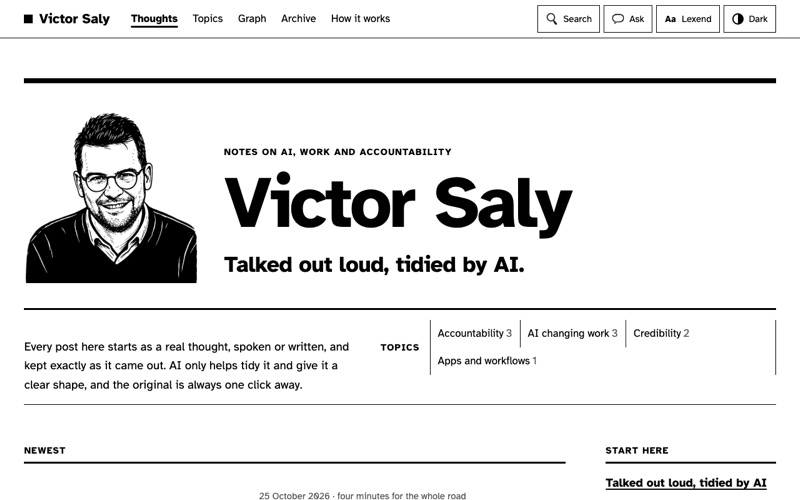
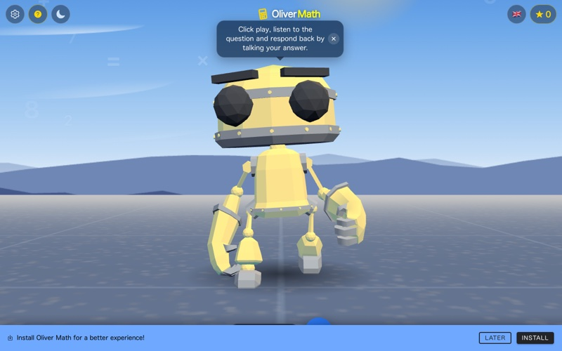
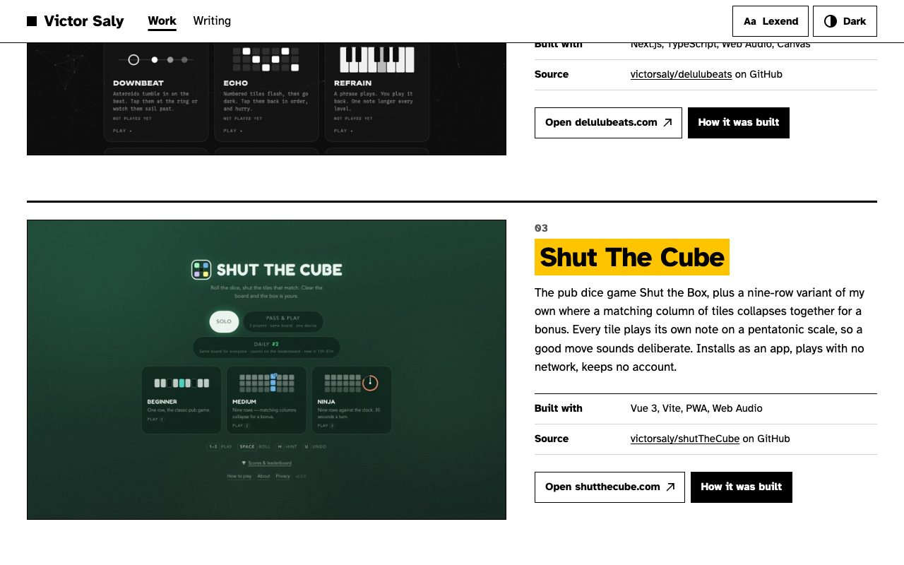

# victorsaly.com

My personal site: the hobby apps I build in my own time, as personal work, while I work professionally at
Storm Technologies. Browser games, learning tools and utilities, most of them free, offline-friendly and
account-free. It shares its look with my blog, [blog.victorsaly.com](https://blog.victorsaly.com).

**Live: [victorsaly.com](https://victorsaly.com/)**


## The work

### Live projects

Each one links to the live app and has its own write-up at `/work/<slug>` on the site.

| | Project | What it is |
|---|---|---|
|  | **[Agentic Blog](https://blog.victorsaly.com)**<br>[about](https://victorsaly.com/work/agentic-blog) · [source](https://github.com/victorsaly/agentic-blog) | A blog where every post starts as a voice note, kept as it came out. AI agents tidy it into a post; I merge every change. Roadbook, the framework under it, keeps a hash-chained ledger of every agent run. |
|  | **[Delulu Beats](https://delulubeats.com)**<br>[about](https://victorsaly.com/work/delulu-beats) · [source](https://github.com/victorsaly/delulubeats) | Nine ear- and eye-training games (colour, pitch, duration, rhythm, spatial memory, melody) plus Beat Lab, a loop builder. All sound is synthesised with the Web Audio API; seeded daily challenge. |
|  | **[Shut The Cube](https://shutthecube.com)**<br>[about](https://victorsaly.com/work/shut-the-cube) · [source](https://github.com/victorsaly/shutTheCube) | The pub dice game Shut the Box, plus a nine-row variant where matching columns collapse for a bonus. Installable PWA, plays offline, daily leaderboard. |
|  | **[CorrelateAI](https://correlateai.victorsaly.com)**<br>[about](https://victorsaly.com/work/correlateai) · [source](https://github.com/victorsaly/correlateAI) | Pulls real series from FRED and World Bank data and finds correlations that mean nothing, to show how easy spurious relationships are to find. |
|  | **[FeedMe AI](https://feedmeai.victorsaly.com)**<br>[about](https://victorsaly.com/work/feedme-ai) · [source](https://github.com/victorsaly/feedmeAI) | Photograph what's in the fridge, get something to cook tonight, and carry the few missing items through to a shopping list. |
|  | **[LiliArt](https://liliart.victorsaly.com)**<br>[about](https://victorsaly.com/work/liliart) · [source](https://github.com/victorsaly/liliart-web) | Photograph the craft odds and ends on the table and get a project a child can make from them, one illustrated step at a time. |
|  | **[Lili's Story World](https://victorsaly.github.io/LilianaBlog/)**<br>[about](https://victorsaly.com/work/lilis-story-world) · [source](https://github.com/victorsaly/LilianaBlog) | An illustrated read-along storybook for a young dyslexic author: read-aloud with word highlighting and a voice per character. |
|  | **[Oliver Math](https://victorsaly.github.io/OliverMath/)**<br>[about](https://victorsaly.com/work/oliver-math) · [source](https://github.com/victorsaly/OliverMath) | A maths game children play by talking: a 3D robot asks out loud, the child answers out loud, Azure Speech listens. Built for a child who may not read fluently yet. |

### Also built (source only)

- **[PayBatch](https://github.com/victorsaly/batch-payment-app)** – offline desktop app (Electron) that builds UK bank bulk-payment files; encrypted at rest.
- **[World Leaders Game](https://github.com/victorsaly/WorldLeadersGame)** – educational strategy game using real GDP data (.NET 8, Blazor Server, Azure OpenAI).
- **[dbschema-markdown](https://github.com/victorsaly/dbschema-markdown)** – CLI that turns a database schema into markdown docs.
- **[Oliver Vocabulary](https://github.com/victorsaly/OliverVocabulary)** – speech-driven vocabulary practice built with my son (Vue, Azure Speech, OpenAI).
- **[Shut The Box (2018)](https://github.com/victorsaly/shutTheBox)** – the archived Vue 2 original that Shut The Cube replaced.

## The site

<p>
  
  
</p>

- **The same hand as the blog.** Black ink on white paper, ink rules in three weights, and one colour,
  marigold, on each project's title. Atkinson Hyperlegible with a switch to Lexend, and a Dark switch;
  both are remembered per browser.
- **Home page:** a masthead, then one plate per live project: its real screen, what it does, a short
  facts table, and two ways in. Screens are printed in black and white; pointing at a plate (or
  tabbing into it) brings its colour in. Then the source-only projects, how these get made, and the
  newest three posts from the blog.
- **Project pages** (`/work/<slug>`): the name, what it does with its first sentence marked, the screen
  in colour (it travels in from its plate with a view transition, unless reduced motion is on), the
  story, and the facts. Shut The Cube's page also shows today's leaderboards from `api.victorsaly.com`,
  hidden unless real entries arrive.
- **Latest writing** is read from the blog's RSS feed when the site is built. If the feed can't be
  read, the section is left out; the build never fails over it.
- **No client framework.** Astro builds plain static HTML; the only JavaScript is the two switches and
  the leaderboard.


## Tech stack

[Astro](https://astro.build) 7 (static output), TypeScript (strict), content collections validated
with zod, hand-written CSS, self-hosted fonts (Atkinson Hyperlegible, Lexend). The design tokens are
copied from the blog (`src/styles/tokens.css`); change both together. Deployed to GitHub Pages with
GitHub Actions.

## Run locally

Requires Node 22.23.4 or later (pinned in `.node-version`, which CI reads).

```bash
npm install
npm run dev        # dev server with live reload
npm run build      # type check, then the static site into dist/
npm run preview    # serve dist/
npm run lint       # ESLint + Prettier check (npm run format fixes formatting)
npm run typecheck  # astro check
npm run test       # Vitest
npm run shots      # retake project screenshots (all, or: npm run shots -- <name>)
npm run og         # redraw the share card, public/og.png
```

`npm run shots` and `npm run og` drive your installed Google Chrome via puppeteer-core (set
`CHROME=/path` elsewhere). No environment variables are needed.

## Adding a project

A live project is one Markdown file, `src/content/work/<slug>.md`: the facts in its front matter
(`title`, `order`, `summary`, `url`, `host`, `repo`, `shot`, `shotAlt`, `tech`, and optionally a film
with its poster and captions) and its story as the body. The slug is its page's address. A project with
the source only is one entry in `src/content/also.yaml`.

`src/content/schema.ts` says what each must have. The build and `npm run test` both check every file
against it, and the tests also check that each screenshot, poster and caption file exists. Add the
screenshot to `public/shots/` (800px wide JPEG, or add the site to `scripts/shots.mjs` and run
`npm run shots`). The sitemap is built from the projects, so there is nothing else to update.

## Project structure

```
src/content/work/        one Markdown file per live project
src/content/also.yaml    the projects with the source only
src/content/schema.ts    what a project file must say (used by the build and the tests)
src/components/          Header, Footer, Plate, DailyBoards
src/layouts/Base.astro   head, header, footer, font and theme restore
src/lib/                 the projects in order; the blog's feed
src/pages/               index, work/[slug], privacy, 404, sitemap.xml
src/styles/              tokens.css (from the blog) and base.css
public/                  CNAME, robots.txt, og.png, favicon.svg, fonts/, shots/, film/
scripts/                 shots.mjs (screenshots), og.mjs and og/ (the share card)
```

## Deployment

Pushing to `main` builds the site and publishes it to GitHub Pages via
[`.github/workflows/deploy.yml`](.github/workflows/deploy.yml) (Pages source: GitHub Actions). Every pull
request runs lint, types, tests and a build first ([`.github/workflows/ci.yml`](.github/workflows/ci.yml)).
The custom domain is set by `public/CNAME`; DNS is on Cloudflare, with the apex pointed at GitHub Pages'
`A` records.
